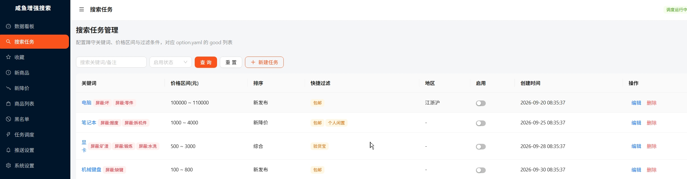

# GooFish - 咸鱼蹲物

自己用的咸鱼蹲物脚本，监控咸鱼关键词下的商品上新与降价，命中后通过本地系统通知或微信公众号模板消息提醒。
你们需要用的话，最好有点编程基础，我不太想做成人人能用的，局子在呼唤……
我偶尔买几件东西，花2、3天写代码本身就觉得亏了，没这个时间成本……以后也基本不会更新和修BUG。

## 功能

- 多关键词搜索任务，按页数与间隔循环爬取
- 新商品自动入「新商品」队列，用户审核后收录或拉黑
- 已收录商品降价时自动标记并提醒
- 三路推送：页面内提示、Windows 系统通知（默认开）、微信公众号逐条推送（默认关，需配置凭证）
- 反爬策略：页间随机停顿、任务间停顿、轮次间隔 ±25% 浮动

## 快速开始

- **普通用户**：下载 [release/咸鱼蹲物.zip](release/咸鱼蹲物.zip)，解压双击「启动.bat」，浏览器自动打开管理面板
- **详细说明**：详见 [说明/说明.md](说明/说明.md)

## 微信推送配置

如需微信通知，请看 [说明/微信通知/微信推送.md](说明/微信通知/微信推送.md)

## 常见问题
 - 问题：HTTP 端口绑定失败（端口已被占用，说明后台已在运行，请勿重复启动）: [WinError 10048] 通常每个套接字地址(协议/网络地址/端口)只允许使用一次。   
   解决方法：请先关闭已运行的后端实例，再启动，详见 [说明/说明.md](说明/说明.md) 中关于强制关闭方法的说明。