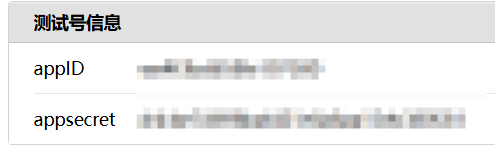
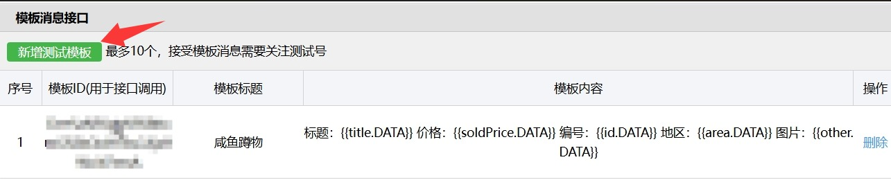
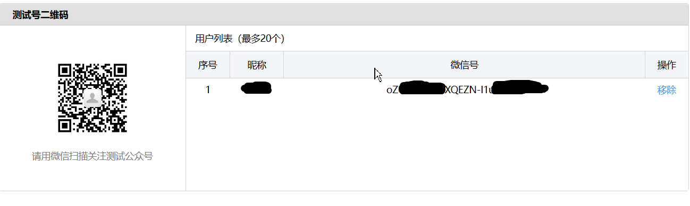

# 微信推送配置说明

如需使用微信推送，需要自己开通**测试公众号**。开通方法不在此赘述，建议自行看关于测试公众号发给自己消息的视频教程或询问 AI，比文字更清晰明了。

## 一、注册

注册网站：<https://mp.weixin.qq.com/debug/cgi-bin/sandboxinfo?action=showinfo&t=sandbox/index>

## 二、在测试公众号平台获取如下所需参数填入 wechat_option.yaml 中

- appID
- appsecret
- 模板ID
- 推送用户ID

## 三、配置步骤

### 1. 获取 appID 和 appsecret



### 2. 新增模板



点击**新增模板**，填入模板内容：

```
标题：{{title.DATA}}
价格：{{soldPrice.DATA}}
编号：{{id.DATA}}
地区：{{area.DATA}}
图片：{{other.DATA}}
```

### 3. 获取推送用户ID



想要收消息的微信扫码之后生成 userid，填入配置中。
